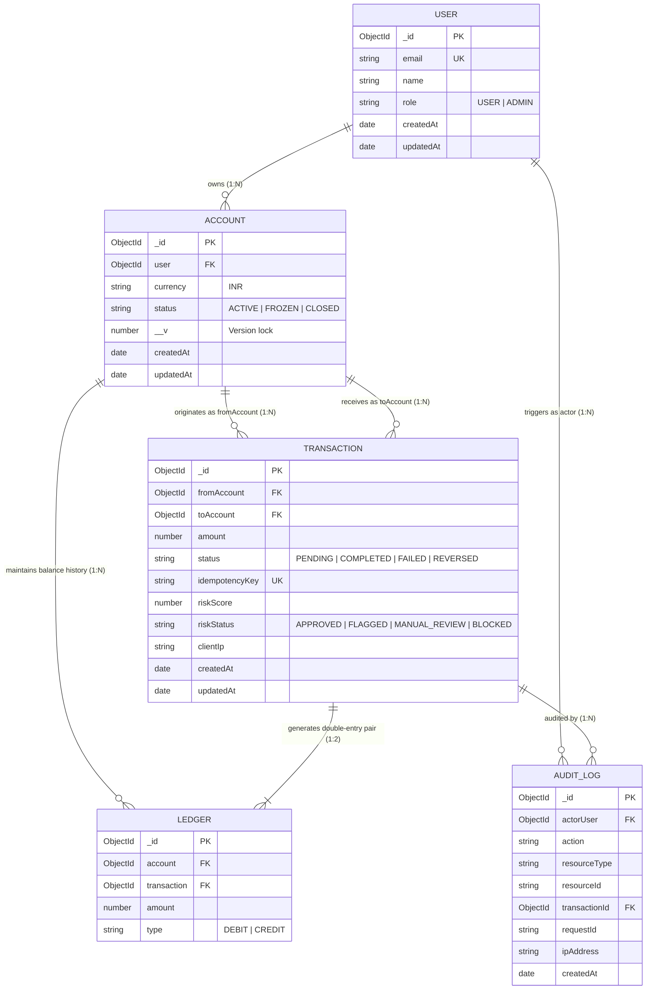

# Database Architecture & Schema Specification

This document provides the database design, schema relationships, index specifications, and immutability invariants for the **Banking Ledger** platform, backed by MongoDB Atlas with WiredTiger storage.

---

## 1. Entity-Relationship Model

---

## 2. Collection Schemas & Indexing Strategy

### A. `users` Collection ([`user.model.js`](file:///c:/Users/RITU%20RAJ/OneDrive/Desktop/banking-ledger/backend/src/models/user.model.js))
* **Purpose:** Stores user identities, authentication credentials, and system roles.
* **Key Fields:**
  * `email` (String, unique, lowercase, trimmed): User email identifier.
  * `password` (String, min length 6, `select: false`): Bcrypt salted hash.
  * `role` (String, enum: `["USER", "ADMIN"]`, default: `"USER"`): System privilege tier.
  * `systemUser` (Boolean, default: `false`, `select: false`): Internal system accounts.
* **Indexes:**
  * `{ email: 1 }` (Unique): Enforces single account per email.
  * `{ createdAt: -1 }`: Eliminates in-memory sorting on administrative user listings.

### B. `accounts` Collection ([`account.model.js`](file:///c:/Users/RITU%20RAJ/OneDrive/Desktop/banking-ledger/backend/src/models/account.model.js))
* **Purpose:** Represents individual financial accounts owned by users.
* **Key Fields:**
  * `user` (ObjectId $\rightarrow$ `users`, required): Account owner.
  * `currency` (String, default: `"INR"`): Account currency.
  * `status` (String, enum: `["ACTIVE", "FROZEN", "CLOSED"]`, default: `"ACTIVE"`).
  * `__v` (Number, Mongoose internal version): Increment target for transaction document write locks.
* **Derived Balance:** Accounts do **not** store a mutable balance field. Balance is dynamically computed from associated entries in the `ledgers` collection.
* **Indexes:**
  * `{ user: 1 }`: Rapid lookup of accounts belonging to a specific user.

### C. `transactions` Collection ([`transaction.model.js`](file:///c:/Users/RITU%20RAJ/OneDrive/Desktop/banking-ledger/backend/src/models/transaction.model.js))
* **Purpose:** Records intent, execution state, risk screening, and idempotency keys for fund movements.
* **Key Fields:**
  * `fromAccount` (ObjectId $\rightarrow$ `accounts`): Debited account.
  * `toAccount` (ObjectId $\rightarrow$ `accounts`): Credited account.
  * `amount` (Number, positive): Transfer value.
  * `idempotencyKey` (String, unique): Client-supplied deduplication key.
  * `status` (String, enum: `["PENDING", "COMPLETED", "FAILED", "REVERSED"]`).
  * `riskScore` (Number, 0–100): Calculated fraud risk assessment.
  * `riskStatus` (String, enum: `["APPROVED", "FLAGGED", "MANUAL_REVIEW", "BLOCKED"]`).
  * `riskReasons` (Array of Strings): Triggered heuristic rules.
* **Indexes:**
  * `{ idempotencyKey: 1 }` (Unique): Hardware-enforced guarantee against duplicate transaction execution.
  * `{ fromAccount: 1, toAccount: 1, status: 1 }`: Historical beneficiary lookups.
  * `{ fromAccount: 1, status: 1, createdAt: -1 }`: User statement generation.
  * `{ status: 1, createdAt: -1 }`: Administrative status filtering.
  * `{ riskStatus: 1, createdAt: -1 }`: Real-time risk monitoring portal.
  * `{ createdAt: -1 }`: Time-series sorting.

### D. `ledgers` Collection ([`ledger.model.js`](file:///c:/Users/RITU%20RAJ/OneDrive/Desktop/banking-ledger/backend/src/models/ledger.model.js))
* **Purpose:** Immutable append-only double-entry bookkeeping records. Every transfer creates exactly two entries: 1 DEBIT and 1 CREDIT.
* **Key Fields:**
  * `account` (ObjectId $\rightarrow$ `accounts`, required, immutable): Target account.
  * `amount` (Number, positive, immutable): Value transferred.
  * `transaction` (ObjectId $\rightarrow$ `transactions`, required, immutable): Parent transaction.
  * `type` (String, enum: `["DEBIT", "CREDIT"]`, required, immutable).
* **Immutability Invariants:**
  * Mongoose pre-hooks strictly throw errors on `updateOne`, `updateMany`, `deleteOne`, `deleteMany`, `findOneAndUpdate`, and `findOneAndDelete`. Records cannot be altered or removed once committed.
* **Indexes:**
  * `{ account: 1, type: 1, amount: 1 }`: **Covered index for balance calculation.** The `$group` balance aggregation satisfies all filter, group, and sum fields directly from RAM without fetching documents from disk (`docsExamined: 0`).
  * `{ transaction: 1 }`: Rapid lookup of double-entry pairs for a transaction.

### E. `audit_logs` Collection ([`auditLog.model.js`](file:///c:/Users/RITU%20RAJ/OneDrive/Desktop/banking-ledger/backend/src/models/auditLog.model.js))
* **Purpose:** Append-only log of security, authorization, financial, and administrative operations.
* **Key Fields:**
  * `actorUser` (ObjectId $\rightarrow$ `users`, nullable): Identity performing the action.
  * `action` (String, required): Event name (e.g. `TRANSACTION_COMPLETED`, `USER_LOGIN`).
  * `resourceType` (String, enum: `["TRANSACTION", "USER", "ACCOUNT", "AUTH", "ADMIN", "RISK", "SYSTEM"]`).
  * `resourceId` (String, nullable): Identifier of affected entity.
  * `requestId` (String, immutable): Request correlation ID.
  * `ipAddress` (String, nullable): Client IP.
  * `metadata` (Mixed, immutable): Sanitized contextual payload.
* **Immutability Invariants:**
  * Pre-hooks block all update, replace, and delete operations. Non-new document `save()` calls are rejected.
* **Indexes:**
  * `{ requestId: 1 }`: Correlation ID lookup (converts full collection scan to index scan).
  * `{ createdAt: -1 }`: Chronological log browsing.
  * `{ action: 1, createdAt: -1 }`: Event-type filtering.
  * `{ resourceType: 1, createdAt: -1 }`: Resource auditing.
  * `{ actorUser: 1, createdAt: -1 }`: User activity audit.

### F. `token_blacklists` Collection ([`blacklist.model.js`](file:///c:/Users/RITU%20RAJ/OneDrive/Desktop/banking-ledger/backend/src/models/blacklist.model.js))
* **Purpose:** Tracks revoked JWT tokens following user logout.
* **Key Fields:**
  * `token` (String, required, unique).
  * `createdAt` (Date, TTL expired after 3 days).
* **Indexes:**
  * `{ token: 1 }` (Unique): Fast membership check on authentication middleware.
  * `{ createdAt: 1 }` (TTL): Automatic deletion after token expiration window.
