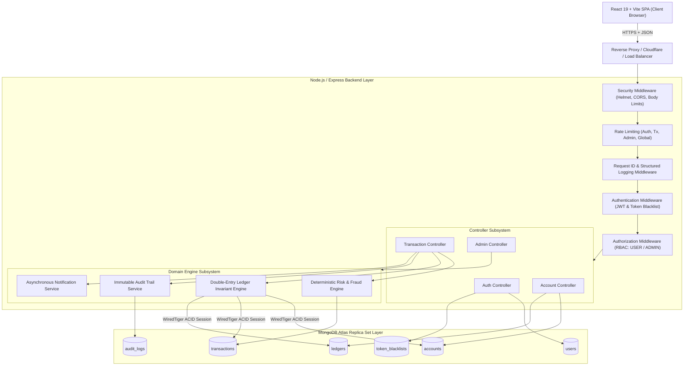
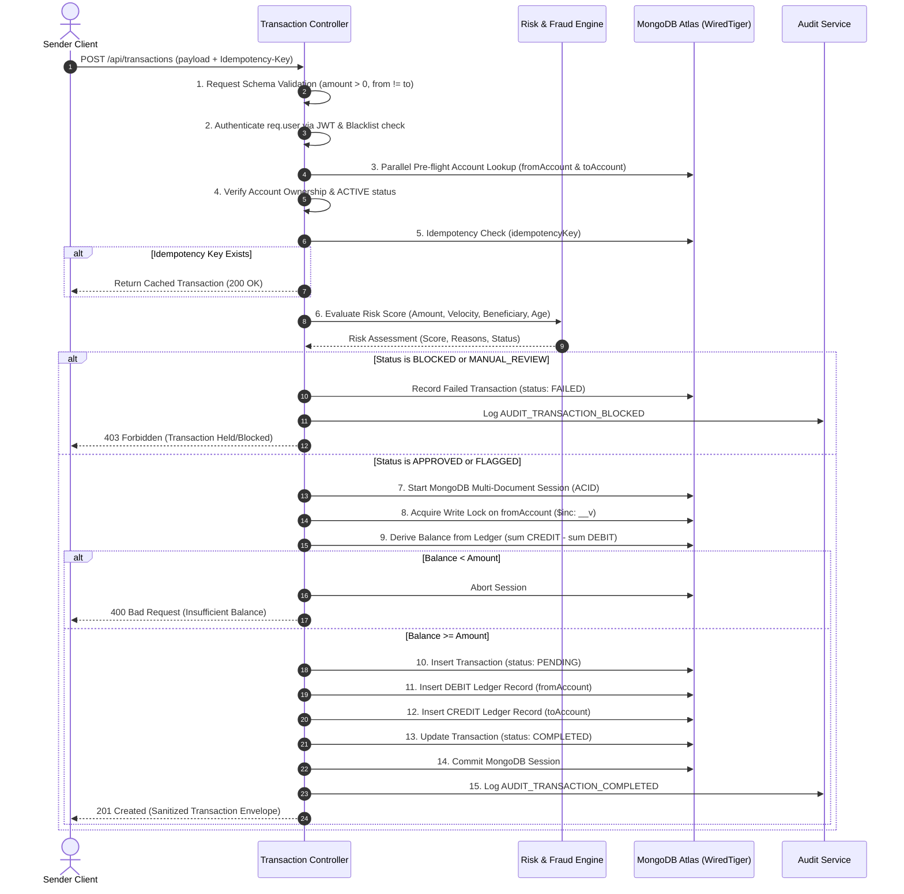
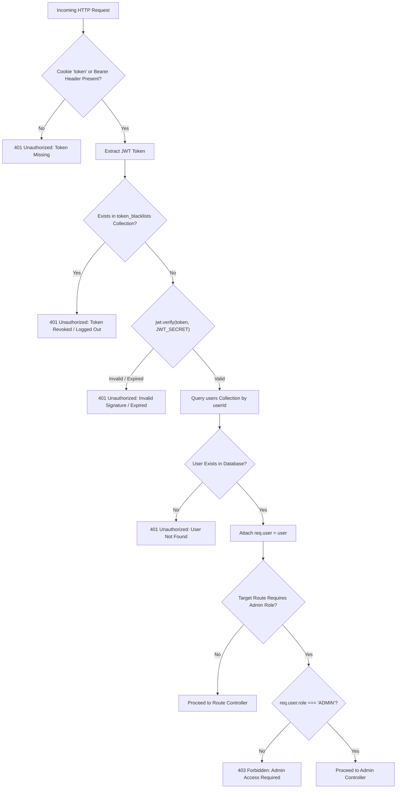
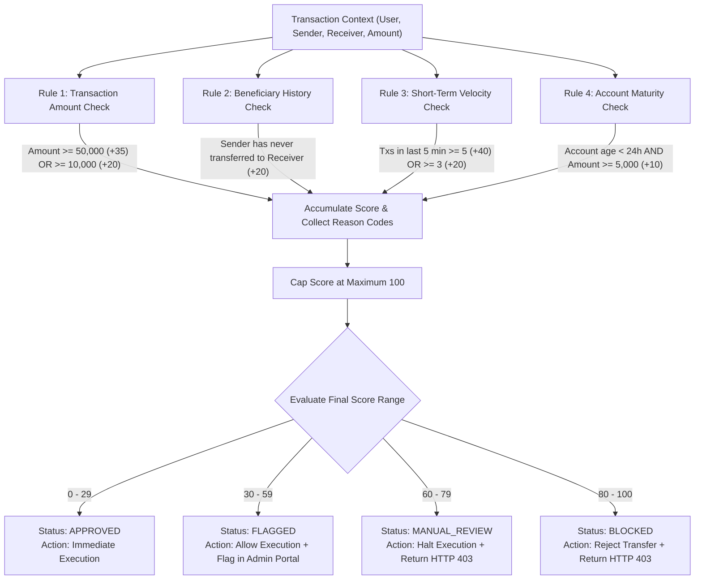

# System Architecture & Technical Specifications

This document details the software architecture, data flow pipelines, security boundaries, and transaction processing lifecycle of the **Banking Ledger** platform.

---

## 1. High-Level System Architecture

The application is structured as a decoupled client-server architecture consisting of a React Single-Page Application (SPA), an Express.js REST API layer, and a MongoDB Atlas replica set with ACID transaction support.



---

## 2. Transaction Processing Lifecycle

Money transfers execute through a 15-step sequence enforcing pre-flight validation, deterministic risk screening, account-level write locks, double-entry bookkeeping, and post-commit auditing.



---

## 3. Authentication & Authorization Architecture

The platform implements dual-transport JWT authentication (HTTP-only secure cookies and `Authorization: Bearer <token>` headers) with database-backed token blacklisting for stateful revocations.



---

## 4. Deterministic Risk & Fraud Evaluation Flow

Risk evaluation runs entirely synchronously prior to transaction boundary initialization. It uses rule-based heuristic weights rather than opaque machine-learning models, providing immediate transparency and auditability.



---

## 5. Immutable Audit Trail Flow

All state transitions, administrative inspections, and authentication lifecycles record an immutable audit entry linked by request correlation IDs.

```mermaid
flowchart LR
    subgraph EventSources["Event Triggers"]
        direction TB
        Ev1["User Registration"]
        Ev2["User Login / Logout"]
        Ev3["Transfer Completed"]
        Ev4["Transfer Blocked"]
        Ev5["Admin Read Operations"]
    end
    
    subgraph Pipeline["Audit Service Pipeline"]
        direction TB
        Corr["Attach req.requestId"]
        IP["Resolve Client IP (Proxy Aware)"]
        Sanitize["Recursive Sensitive Field Masking"]
        Prep["Assemble Audit Document"]
    end
    
    subgraph ImmutabilityEnforcement["Mongoose Collection Guard"]
        direction TB
        Hook1["pre('updateOne') -> Reject"]
        Hook2["pre('updateMany') -> Reject"]
        Hook3["pre('deleteOne') -> Reject"]
        Hook4["pre('deleteMany') -> Reject"]
        Hook5["pre('save') (non-new) -> Reject"]
    end

    EventSources --> Corr
    Corr --> IP
    IP --> Sanitize
    Sanitize --> Prep
    Prep -->|insert() only| ImmutabilityEnforcement
    ImmutabilityEnforcement --> DB[("audit_logs Collection")]
```
